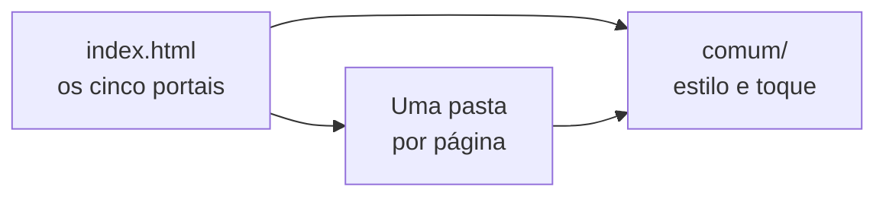
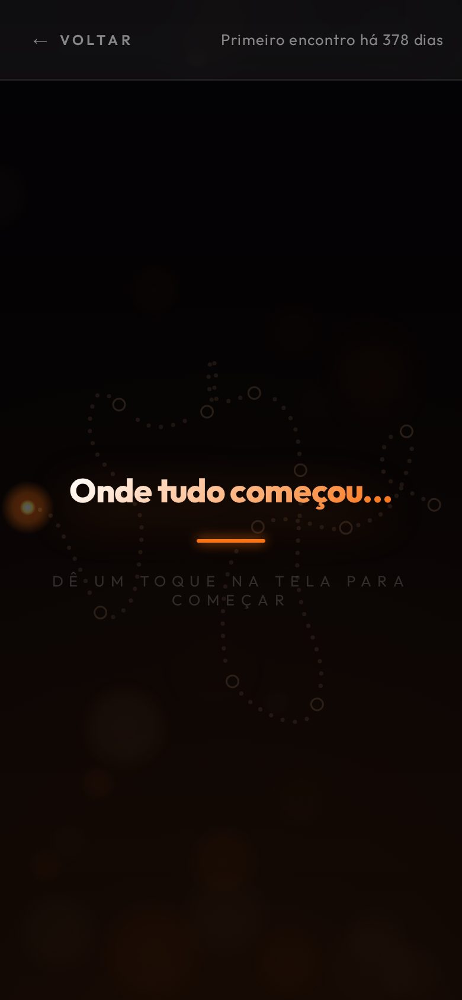
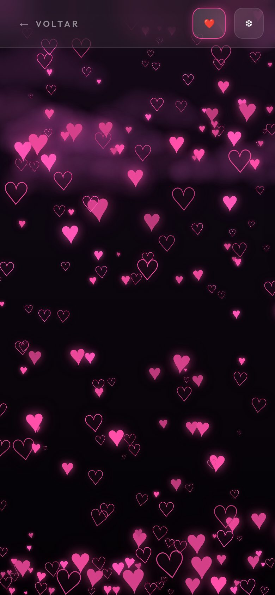
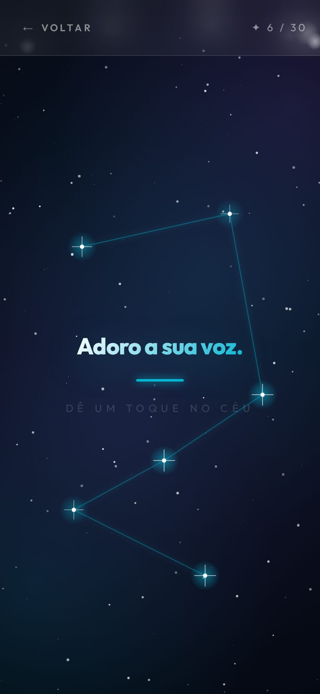
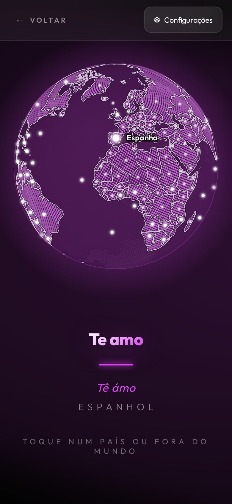

<div align="center">


# Portal do Afeto

**Cinco portais, cada um com um jeito de dizer que eu te amo: um caminho, uma chuva, uma constelação, uma
volta ao mundo e uma pergunta.**

</div>

<p align="center">
  
</p>

O Portal do Afeto é um site para abrir no celular e tocar na tela. Cada portal conta uma parte da história
do seu jeito, desenhado ao vivo em canvas, e em todas as páginas o toque solta corações.

> [!NOTE]
> Só em português do Brasil. Feito primeiro para o celular, em pé ou deitado. Sem build nem dependências:
> HTML, CSS e JavaScript puro.

## O que ele faz

- **Primeiro Encontro:** a noite contada em 12 paradas, por um caminho de pedrinhas com o nome dos lugares.
  No fim, as pedrinhas voam e o caminho vira um coração que acende e pulsa.
- **Chuva de Corações:** faz chover até o amor não caber na tela. Os corações se empilham, juntam num
  coração grande e explodem, debaixo de nuvens que relampejam.
- **Constelação:** cada toque acende uma estrela e um elogio. No fim, o desenho vira uma constelação com nome,
  e cada estrela guarda o seu elogio para reler.
- **Volta ao Mundo:** um eu te amo em 121 idiomas, com a pronúncia escrita, num globo que gira até onde cada
  um se fala. Arrastar gira o globo; tocar num país mostra a língua de lá.
- **Um Pedido:** uma pergunta muito importante, debaixo de pétalas caindo. O "Não" foge.
- **Em todas as páginas:** um toque rápido solta um coração; segurar faz um crescer e explodir. Espaço, Enter
  e Seta Direita fazem o mesmo que o toque.

## Como funciona



A página inicial abre os portais, e cada página mora na sua pasta, com o `index.html`, um CSS e um JS com o
nome dela. O que todas usam (a base visual, o toque e as cores lidas do CSS) fica em `comum/`. As animações
são desenhadas em canvas, sem imagem nenhuma.

## Telas

<table>
  <tr>
    <td width="33%">
      
      <p align="center">Onde tudo começou</p>
    </td>
    <td width="33%">
      
      <p align="center">A chuva enchendo a tela</p>
    </td>
    <td width="33%">
      
      <p align="center">Uma estrela e um elogio</p>
    </td>
  </tr>
  <tr>
    <td width="33%">
      
      <p align="center">O globo e o te amo de lá</p>
    </td>
    <td width="33%">
      
      <p align="center">A pergunta</p>
    </td>
    <td width="33%"></td>
  </tr>
</table>

## Rodar

Precisa de Python 3 (só para servir os arquivos) e de um navegador. Os módulos JS não abrem por `file://`.

```bash
python3 -m http.server     # o site em http://localhost:8000
```

Antes de publicar, `node .github/scripts/verificar.mjs` confere a sintaxe dos JS e se todo arquivo citado
existe. O GitHub Actions roda essa verificação e, se ela passar, publica na `main` pelo GitHub Pages.

## Documentação

- [`CLAUDE.md`](./CLAUDE.md): o padrão visual, a estrutura das pastas e como verificar o site.
